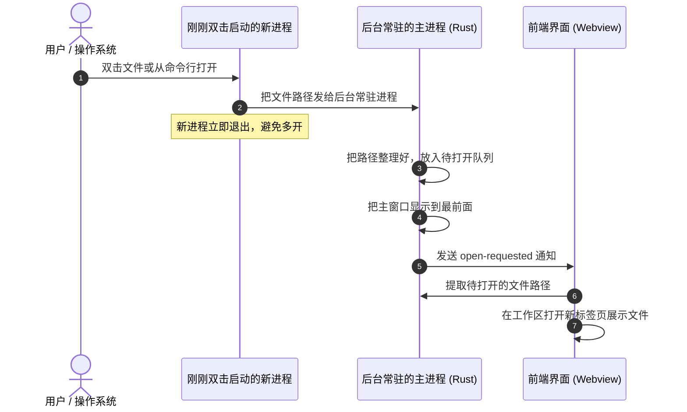
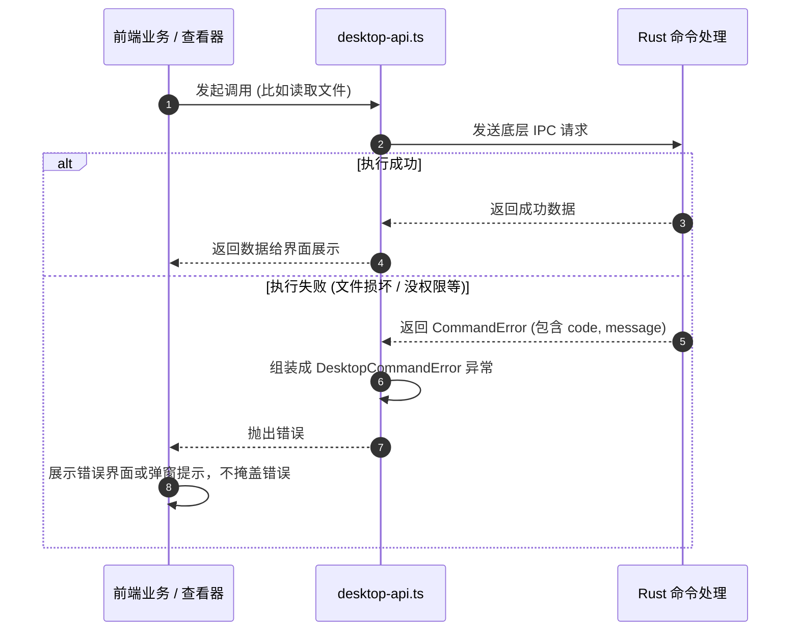

# 系统总体架构与通信规则

## 目标

KView 基于 Tauri 2 (Rust) 与 Vue 3 构建。本设计旨在理清前端与底层的职责分工，规范数据从外部传入时的校验方式，统一前后端通信接口与报错机制，让系统结构清晰、问题易排查。

## 边界

### 负责范围
- **进程与窗口管理**：只允许单实例运行，支持托盘隐藏常驻与快速唤醒。
- **外部数据入口检查**：规范外部传入的文件路径、命令行参数、拖拽文件和网络 URL，避免脏数据进入系统内部。
- **前后端通信与统一报错**：定义 Rust 报错结构体与前端错误对象的对应关系，确保出错时直接暴露，不掩盖问题。
- **配置持久化与日志落盘**：管理用户设置的本地保存以及崩溃诊断日志。

### 不负责范围
- 不负责具体某种特殊文件（如 Office、压缩包）的内部解析细节。
- 不负责具体组件的 UI 样式细节。

## 规则

1. **边界校验与规范化 (System Boundary)**：
   - 用户拖拽进来的文件、命令行传参、系统双击打开的路径都是外部不可信数据，必须在刚刚进入 Rust 命令或前端 API 入口时统一检查并转成标准绝对路径。
   - 数据一旦进入内部的 Service 和状态管理（Pinia）中，就默认是合法可用的，内部各模块不需要重复写一堆防御性的 `if` 判断。
2. **立即失败原则 (Fail Fast)**：
   - 遇到程序无法处理的错误时，必须直接抛出异常；禁止用 `catch` 吞掉错误然后返回空对象，也不要偷偷给假数据装作成功。
   - Rust 后台报错统一用包含错误码和错误信息的结构体（`CommandError`）；前端收到后转为标准错误并在界面上弹出提示或展示报错页，方便用户知道问题在哪。
3. **保持单实例运行，关闭窗口默认留在托盘**：
   - 软件只保持一个主进程运行。如果用户在系统里双击关联文件再次打开软件，新进程会把文件路径传给已经运行的后台，然后自己退出。
   - 单实例按运行环境隔离：Rust 调试构建在应用初始化前使用 `com.kentxxq.kview.dev` 标识，与安装版可同时运行，各自使用独立的配置、WebView 数据与日志目录；同一环境仍保持单实例。
   - 开发版系统窗口标题、托盘提示及打开/退出菜单显示 `KView DEV`，原生图标带橙色 DEV 角标；前端开发模式在标题栏显示 DEV 徽标。正式发布版保留原有名称和图标。
   - 用户点击窗口右上角“关闭”时，窗口只是隐藏到系统托盘，而不是退出程序。只有在托盘菜单里显式点击“退出”时，程序才会真正关闭。

## 模块职责

```
┌────────────────────────────────────────────────────────┐
│                   前端 Vue 3 (界面展示与状态)           │
│  - 界面呈现：AppShell / Workspace / ViewerHost         │
│  - 状态管理：Pinia (工作区标签、当前文档、用户设置)    │
│  - 系统服务：desktop-api, desktop-lifecycle            │
└───────────────────────────▲────────────────────────────┘
                            │ Tauri IPC (命令调用与事件监听)
┌───────────────────────────▼────────────────────────────┐
│                   底层 Tauri 2 / Rust 后台             │
│  - lib.rs (窗口显示与隐藏、单实例监听、托盘菜单)       │
│  - command_error.rs (统一错误格式)                     │
│  - settings.rs (读写本地配置文件、开机自启)            │
│  - diagnostics.rs (记录排查日志)                       │
└────────────────────────────────────────────────────────┘
```

- **Rust 后台核心 (`lib.rs` / `command_error.rs`)**：管理主窗口、系统托盘、外部文件打开队列，并提供所有底层文件读取和系统操作命令。
- **前端适配层 (`desktop-api.ts` / `desktop-lifecycle.ts`)**：封装底层通信方法，统一捕获网络/调用错误，并转成前端认识的异常。
- **状态中枢 (`src/state/`)**：用 Pinia 集中管理多标签页、当前打开的文档内容以及软件配置。

## 流程

### 1. 软件唤起与打开文件流程



### 2. 统一调用与报错处理流程



## 关键决策

1. **采用结构化错误信息，而不是单纯的错误字符串**：
   - *决策*：底层所有命令出错时，都返回包含“错误代号 (code)”和“可读文字 (message)”的对象。
   - *原因*：只返回一串文本的话，前端很难判断是“编码不支持”、“文件太大”还是“格式损坏”。用固定的错误代码可以让前端更准确地给用户提示或自动推荐其他打开方式。
2. **窗口最小化常驻后台，秒级二次唤醒**：
   - *决策*：点击关闭时只是把窗口藏到托盘，不销毁浏览器内核。
   - *原因*：文件查看器最重要的就是“随点随开”。如果每次关闭都彻底退出，下次打开就要重新初始化前端框架和样式，常驻后台可以让再次打开时基本在 0.1 秒内瞬间显示。
