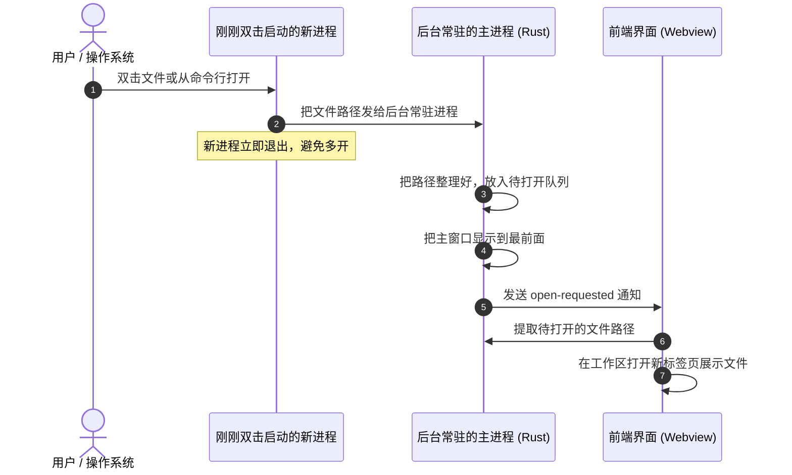
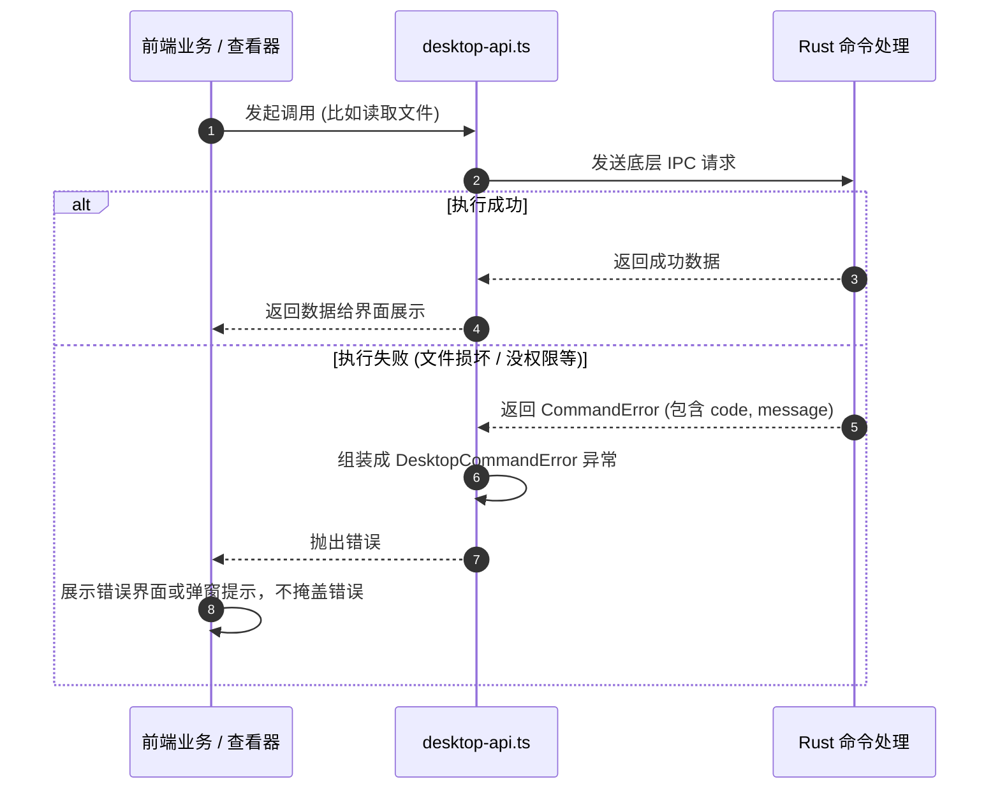

# 系统总体架构与通信规则

## 目标

KView 基于 Tauri 2 (Rust) 与 Vue 3 构建。本设计旨在理清前端与底层的职责分工，规范数据从外部传入时的校验方式，统一前后端通信接口与报错机制，让系统结构清晰、问题易排查。

## 边界

### 负责范围
- **进程与窗口管理**：只允许单实例运行，支持托盘隐藏常驻与快速唤醒。
- **外部数据入口检查**：规范外部传入的文件路径、命令行参数、拖拽文件和网络 URL，避免脏数据进入系统内部。
- **前后端通信与统一报错**：定义 Rust 报错结构体与前端错误对象的对应关系，确保出错时直接暴露，不掩盖问题。
- **配置持久化与日志落盘**：管理用户设置的本地保存以及崩溃诊断日志。

### 不负责范围
- 不负责具体某种特殊文件（如 Office、压缩包）的内部解析细节。
- 不负责具体组件的 UI 样式细节。

## 规则

工作区通过标签页和组件状态导航，不使用 URL 路由；Nuxt UI 显式关闭路由集成，不依赖 Vue Router 的运行期注入。

1. **边界校验与规范化 (System Boundary)**：
   - 用户拖拽进来的文件、命令行传参、系统双击打开的路径都是外部不可信数据，必须在刚刚进入 Rust 命令或前端 API 入口时统一检查并转成标准绝对路径。
   - 数据一旦进入内部的 Service 和状态管理（Pinia）中，就默认是合法可用的，内部各模块不需要重复写一堆防御性的 `if` 判断。
   - 空白工作区粘贴时优先处理剪贴板图片，其次识别单行本地路径，再沿用 URL 与普通文本入口。路径支持盘符绝对路径、UNC、以 `/` 开头及以 `%变量名%` 开头的路径；识别时移除首尾空白和成对双引号，多行内容保持普通文本。
   - 粘贴路径通过 `resolve_pasted_path` 在 Rust 边界解析：Windows 环境变量只展开一次，不执行 Shell；展开后必须为当前系统的绝对文件路径，并复用文件访问模块验证和规范化，再进入现有本地文件打开流程。未定义环境变量、目录或不可访问路径明确报错，不回退为文本；不扩展相对路径、`~`、`$VAR`、`${VAR}` 或 `file://`。
2. **立即失败原则 (Fail Fast)**：
   - 遇到程序无法处理的错误时，必须直接抛出异常；禁止用 `catch` 吞掉错误然后返回空对象，也不要偷偷给假数据装作成功。
   - Rust 后台报错统一用包含错误码和错误信息的结构体（`CommandError`）；前端收到后转为标准错误并在界面上弹出提示或展示报错页，方便用户知道问题在哪。
3. **保持单实例运行，关闭窗口默认留在托盘**：
   - 软件只保持一个主进程运行。如果用户在系统里双击关联文件再次打开软件，新进程会把文件路径传给已经运行的后台，然后自己退出。
   - 单实例按运行环境隔离：Rust 调试构建在应用初始化前使用 `com.kentxxq.kview.dev` 标识，与安装版可同时运行，各自使用独立的配置、WebView 数据与日志目录；同一环境仍保持单实例。
   - 开发版系统窗口标题、托盘提示及打开/退出菜单显示 `KView DEV`，原生图标带橙色 DEV 角标；前端开发模式在标题栏显示 DEV 徽标。正式发布版保留原有名称和图标。
   - 用户点击窗口右上角“关闭”时，窗口只是隐藏到系统托盘，而不是退出程序。只有在托盘菜单里显式点击“退出”时，程序才会真正关闭。
   - Windows 托盘菜单提供“关于”入口，唤起主窗口并直接打开现有设置弹窗的关于分区，复用版本展示和手动检查更新；打开关于本身不额外触发更新检查。打开请求由后台保留至前端消费，以支持低内存模式下的窗口重建，重复待处理请求合并；安装更新期间不接受该入口请求。

### HTML 预览的权限隔离

- 外部 HTML 不进入应用主文档，而是在 `sandbox="allow-scripts"` 的 iframe 中执行；不授予同源权限，不能读取主页面 DOM、状态或 IPC 密钥，主页面不提供 postMessage 原生调用代理。
- 独立资源协议仅暴露当前预览会话及其目录资源。主页面 CSP 只增加该 iframe 所需的 frame-src，保持原有 script-src 和 connect-src。
- 不能把自定义协议本身当成 IPC 权限隔离：Tauri 可能将注册协议视为本地来源。当前 Tauri 的初始化脚本及 IPC 调用密钥仅注入主 frame；所有原生调用强制核对密钥，HTTP IPC 还要求合法的 Origin，拒绝沙箱页面的 null Origin。升级 Tauri 时需复核这两条底层约束。
- 预览允许联网，因此页面脚本能够发送其可读取的文档内容与目录资源；访问范围限于用户打开 HTML 的所在目录及子目录，不开放任意磁盘读取。

## 模块职责

```
┌────────────────────────────────────────────────────────┐
│                   前端 Vue 3 (界面展示与状态)           │
│  - 界面呈现：AppShell / Workspace / ViewerHost         │
│  - 状态管理：Pinia (工作区标签、当前文档、用户设置)    │
│  - 系统服务：desktop-api, desktop-lifecycle            │
└───────────────────────────▲────────────────────────────┘
                            │ Tauri IPC (命令调用与事件监听)
┌───────────────────────────▼────────────────────────────┐
│                   底层 Tauri 2 / Rust 后台             │
│  - lib.rs (窗口显示与隐藏、单实例监听、托盘菜单)       │
│  - command_error.rs (统一错误格式)                     │
│  - settings.rs (读写本地配置文件、开机自启)            │
│  - diagnostics.rs (记录排查日志)                       │
└────────────────────────────────────────────────────────┘
```

- **Rust 后台核心 (`lib.rs` / `command_error.rs`)**：管理主窗口、系统托盘、外部文件打开队列，并提供所有底层文件读取和系统操作命令。
- **文件访问 (`file_access.rs`)**：集中提供本地文件路径规范化、文件元数据检查、路径显示与修改时间转换；具体读取器保留各自的大小、格式及版本校验。
- **文本编解码 (`text_encoding.rs`)**：负责 UTF-8/UTF-16 编解码、BOM 与换行符识别，不管理磁盘访问或文档会话。
- **实时日志 (`log_reader.rs`)**：管理有界尾读和增量读取会话，识别文件替换与截断；具体显示、滚动与着色由前端日志视图负责，不复用静态大文本快照会话。
- **日志布局 (`log-layout.ts`)**：维护按字素分段的字体宽度索引，并仅为横向可视片段生成着色数据；不持有文件会话，不修改原文。Vue Viewer 负责纵向虚拟化与分帧调度。
- 日志注册表持有主窗口代次，主窗口创建和成功销毁时分别激活与失效；异步读取结束后的会话注册必须再次校验代次，避免销毁 WebView 后留下无人接收的会话。
- **文本模型与对比**：文档拥有按需创建的 Monaco 模型，普通 Viewer 和双侧可编辑对比复用；工作区对比标签仅保存源文档引用，统一复用保存与未保存保护。标签缓存绑定各自文档，不从活动标签读取内容。
- **运行期窗口置顶**：Rust 保存进程内置顶状态，原生设置成功后更新，窗口重建时恢复；不写入用户设置，重启后重置。
- **前端适配层 (`desktop-api.ts` / `desktop-lifecycle.ts`)**：封装底层通信方法，统一捕获网络/调用错误，并转成前端认识的异常。
- **状态中枢 (`src/state/`)**：用 Pinia 集中管理多标签页、当前打开的文档内容以及软件配置。

### 文本设置兼容

读取设置及消费待打开请求时，状态锁失败通过统一 IPC 错误返回，不以默认设置或空请求替代；前端入口记录现有诊断事件。

- 设置版本为 4，完整文本编辑默认阈值为 10 MiB；旧版本的 2 MiB 一次性迁移到 10 MiB，其余自定义值保留。无版本配置按旧配置迁移，版本 4 后用户重新设置的 2 MiB 不再被覆盖。
- 全局日志关键词规则随设置持久化，旧配置缺失时初始化为空；窗口置顶、日志阅读状态和对比关系不进入跨启动设置。
- 本地文本阈值与远程 HTML 的 2 MiB 安全限制、原有分块读取大小分别维护，不互相替换。

## 流程

### 1. 软件唤起与打开文件流程



### 2. 统一调用与报错处理流程



## 关键决策

1. **采用结构化错误信息，而不是单纯的错误字符串**：
   - *决策*：底层所有命令出错时，都返回包含“错误代号 (code)”和“可读文字 (message)”的对象。
   - *原因*：只返回一串文本的话，前端很难判断是“编码不支持”、“文件太大”还是“格式损坏”。用固定的错误代码可以让前端更准确地给用户提示或自动推荐其他打开方式。
2. **窗口最小化常驻后台，秒级二次唤醒**：
   - *决策*：点击关闭时只是把窗口藏到托盘，不销毁浏览器内核。
   - *原因*：文件查看器最重要的就是“随点随开”。如果每次关闭都彻底退出，下次打开就要重新初始化前端框架和样式，常驻后台可以让再次打开时基本在 0.1 秒内瞬间显示。
