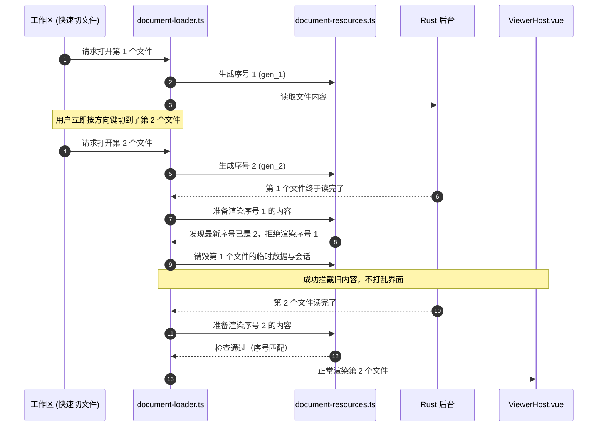
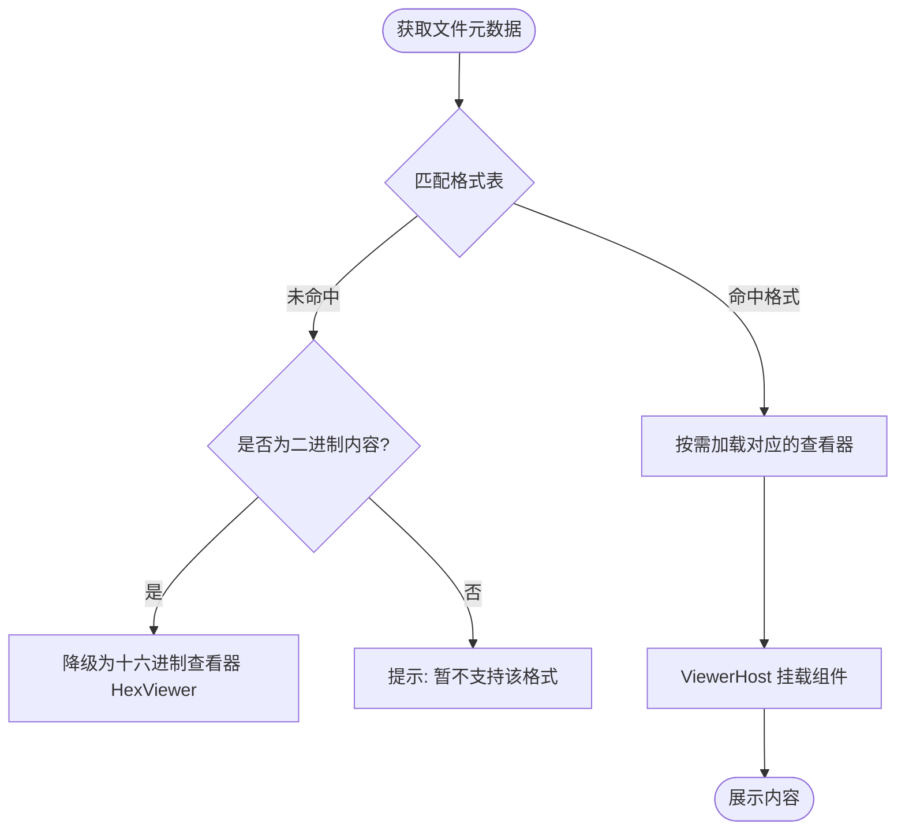

# 文档载入引擎与 Viewer 调度架构

## 目标

KView 支持对代码、文本、音视频、图像、动态照片、Office、PDF、安装包、电子书与压缩包等多类文件的无缝即时查看。本设计规范从文件输入、格式判断、分流加载、查看器异步加载、展示到最后释放资源的完整过程，确保快速切换文件时不卡顿、不串位、不漏内存。

## 边界

### 负责范围
- **格式推断与能力匹配**：根据系统能力清单，通过文件后缀、MIME 或特征名识别文件类型。
- **加载管道与分流策略**：根据识别出的类型，分流读取为二进制、结构化对象、纯文本或大文件流式会话。
- **动态组件路由与按需加载**：查看器按需动态引入（不提前打包所有重型渲染库）。
- **生命周期与资源回收**：及时撤销内存 Blob URL，关闭大文件和电子书在后台的会话句柄，防止快速切文件时旧内容覆盖新内容。

### 不负责范围
- 不负责具体文件解码算法的实现（由各 Viewer 内部库及 Rust 专用解析模块负责）。
- 不负责应用外壳窗口、工具栏及多标签页切换的 UI 逻辑。

## 规则

1. **连续快速切文件时防串位（丢弃过期请求）**：
   - 用户在文件列表里连续按方向键快速移动预览时，会连续触发多次加载。
   - 每次发起加载时都生成一个递增序号（`generation`）。当某次加载完成准备渲染时，必须检查序号是否仍是最新的；如果用户已经切换到了更新的文件，必须直接扔掉这次加载的数据，绝不能把旧文件的内容盖在当前文件上。
2. **用完必须彻底释放资源（防止内存泄漏）**：
   - 任何加载过程中生成的内存临时链接（`URL.createObjectURL`）以及在 Rust 后台占用的长会话（如大文件查看 `largeTextSessionId`、电子书解析 `ebookSessionId`），都必须记录在 `document-resources` 中。
   - 只要切走文件、关闭标签页，或者加载过程中报错，必须立即清理所有临时链接，并通知 Rust 释放后台会话。
3. **大文件自动降级与按需懒加载**：
   - 所有的查看器组件（如 Monaco Editor、ArtPlayer、PDF.js）全部配置为按需动态加载，不拖慢首次启动速度。
   - 文本文件按体积区分策略：普通小文件直接全量加载到编辑器；超过可配置阈值（默认 10 MiB）的大文件自动切换为只读分页流式查看器（`LargeTextViewer`），由后台建立索引并按需拉取行。
4. **PDF 标注与原文件保护**：
   - PDF Viewer 使用 PDF.js 页面、文字选择及标注编辑层，支持文字高亮、自由画笔和添加文字；文档权限不允许编辑时保持只读。
   - 标注是当前文档会话的修改，接入工作区未保存提示与保存快捷键；保存始终通过另存为导出 PDF，Rust 边界禁止覆盖当前源文件，并以同目录临时文件原子写入。
   - 标签切换保留编辑会话，Viewer 缓存淘汰时先导出内存快照再销毁引擎；重新进入该文档时恢复快照。快照按原始二进制对象关联，不写磁盘、不进入会话恢复记录，关闭文档后随文档对象释放。

5. **HTML 源码与页面预览**：
   - `.html`、`.htm` 仍按文本加载和保存，普通文件使用 HTML Viewer，默认源码模式；页面模式渲染当前编辑内容。超过当前编辑阈值（默认 10 MiB）的本地文件继续走大文本查看器，不提供页面模式。
   - 页面运行在仅允许脚本的沙箱 iframe 中，使用独立的随机会话域名和资源协议；主应用不放开内联脚本与网络请求权限。预览允许本地 CSS、图片、普通脚本及模块脚本，以及 HTTP/HTTPS 资源和请求，仍受浏览器 CORS、混合内容及页面自身 CSP 限制；不提供弹窗、顶层跳转、插件对象或 Worker 权限。
   - 本地资源根为 HTML 所在目录。资源协议在边界解码路径并规范化真实路径，禁止目录穿越、Windows 备用数据流及符号链接越界；不接受页面提交任意磁盘路径。各会话使用独立域名，根路径引用也按当前目录解析。
   - 渲染会话只在首次进入页面时创建，归 HTML Viewer 所有；源码模式卸载 iframe，再次进入时更新内容。标签失活、缓存淘汰及组件销毁时卸载页面并关闭会话，回到标签后重新加载。异步会话操作串行执行并丢弃过期渲染结果。
   - 资源读取失败通过协议错误响应和主窗口错误事件展示，创建、更新及释放失败由查看器错误状态或诊断日志呈现，不静默回退到源码。
   - 远程 HTML 与其他远程文本统一支持最大 10 MiB（含边界值），保持只读；超过限制明确报错，不落盘或建立大文本分页会话。页面相对资源以输入的原始 HTTP/HTTPS URL 为基准，保留 HTML 自身的 base 语义，不代理远程子资源或绕过浏览器限制。

6. **远程文件预览**：
   - URL 入口支持图片、PDF、音视频、DOCX、XLS/XLSX，以及共享格式表中的文本、代码、Markdown、JSON、YAML；不接入依赖本地路径的旧版 DOC、PPT、电子书或压缩包。全部保持只读。
   - Rust 边界结合文件头、响应 MIME、下载文件名和重定向后的 URL 识别格式，文件头优先；Office 检查对应容器，DOCX/XLSX 检查内部文档标识，M4A 单独分流为音频。ID3 只作为元数据标签，验证标签头、长度及标签后的音频帧头后才判定音频，不凭 `ID3` 文本前缀分流。无法识别或损坏的内容明确报错。
   - 文本复用共享解码器，支持 UTF-8、UTF-8 BOM、带 BOM 的 UTF-16，返回编码、换行符和 BOM；不支持的编码及二进制文本明确报错。远程文本限制独立于本地可配置的大文件阈值和后台读取分块大小。
   - 下载先执行统一的 200 MiB 上限；收到文件头后结合格式提示确定上限，并检查声明长度及实际接收长度，避免错误 MIME 提前拒绝有效二进制文档。ZIP 容器和有效 ID3 标签在内容完整后进一步识别；最终按实际类型再次检查：文本（含 HTML）10 MiB、图片 100 MiB、其他内容 200 MiB。音视频 Blob URL 纳入现有文档资源管理，过期加载结果不提交。

## 模块职责

### 日志阅读与文本对比

- 所有已识别的本地文本均可通过现有底栏右侧开关进入只读日志模式，不新增独立工具行；进入前处理未保存修改，退出时重新加载磁盘内容。日志模式和可编辑对比互斥，不参与自动跨启动恢复。
- 日志使用独立 Rust 会话，不放宽大文本快照会话的文件变化检查。会话维护真实文件身份、读取偏移及已读尾部校验数据；初次读取末尾最多 10 MiB，增量读取每次最多 1 MiB，保留不完整 UTF-8/UTF-16 字符供下次读取。
- 日志会话绑定主窗口运行期代次。创建命令携带 `windowGeneration`，Rust 在读取前及注册时校验；代次校验和注册共用注册表锁。成功销毁窗口后失效代次、清空会话，重建窗口分配新代次；隐藏和最小化保留代次。旧窗口的后台创建任务不能向新窗口注册会话。
- 前端仅在标签活动、窗口可见且未最小化时每 500 ms 串行读取；暂停滚动不暂停读取。缓冲区同时限制原始文本对应字节数不超过 10 MiB、行数不超过 50,000，防止大量空行产生无界对象开销。优先按行淘汰，超长单行截断；缓冲限制放在底栏说明中，正常跟随不弹出淘汰提示。单行截断在每次连接内短暂提醒一次；暂停时原阅读位置被淘汰则短暂提醒一次，继续跟随后允许下一次提醒，不用常驻横条占据内容区域。
- 日志视图使用虚拟行，不将新增内容回写可编辑文档。向上翻阅自动暂停滚动，继续时定位末尾；文件截断、替换、删除、改写或解码失败时停止跟随并显示原因，重新连接建立当前文件的新会话。失活不丢弃已发出读取的有效结果，避免偏移推进后漏读。
- 关键词使用转义后的纯文本匹配、忽略大小写，优先使用列表靠前的规则；仅匹配文字着色。规则全局保存，初始为空，颜色限红、橙、黄、绿、蓝、紫。
- 日志同时采用纵向行虚拟化和横向布局段虚拟化，保留单行水平滚动。每段最多 512 个字素簇，不拆分 emoji 或组合字符；按实际字体测宽，制表符使用 8 个空格宽度的制表位。可见行轮流建立索引，每帧约 4 ms 工作预算，界面显示未完成布局进度。
- 横向仅渲染可见段与左右各一个预取段。着色只计算这些片段及按关键词长度扩展的跨段上下文，按字素绘制、靠前规则优先；同规则重叠匹配均保留，不限制整行命中数，不生成整行匹配对象或 DOM 节点。布局与着色位于 `log-layout.ts`，Viewer 仅负责连接、滚动、调度和界面。
- 追加内容复用已测前缀并更新尾段；前缀截断使该行索引失效。缓冲淘汰同步释放行索引，重连清空旧索引，字体变化或字体加载完成后重建；Viewer 卸载释放全部缓存和动画帧调度。
- 每个完整文本文档拥有一个按需创建的 Monaco 模型，模型与文档状态双向同步，关闭或重新加载文档时释放；Viewer 卸载只释放编辑器实例。普通文本视图与 Diff Editor 共享模型，不复制编辑缓冲区。
- 对比标签仅引用左右两个普通文档标签及最近焦点侧，固定并排显示，包含空白差异并提供差异导航。两侧独立保存，复用编码、换行符、原子保存和外部修改冲突检测；每侧完整文本须不超过当前编辑阈值。
- 对比入口包括已打开标签配对和文件选择器。相同有序配对复用已有对比标签，禁止同文件自比；对比关闭不关闭源文档，源文档关闭前处理未保存修改并关闭关联对比。批量关闭和应用退出按源文档处理保护，不重复提示。
- 对比菜单只判断类型、来源、只读和日志模式，不在渲染期间编码全文；实际创建对比时，检查两侧最新编辑内容的编码字节数及 BOM。超限明确提示，不创建对比标签。
- 日志会话登记到文档资源管理器，同时由日志 Viewer 在淘汰和卸载时释放；会话关闭可重复调用。异步创建和读取均丢弃过期结果，过期创建结果必须关闭其会话。

### 原生图片与演示文稿

- AVIF、BMP、ICO、JXL、TIF/TIFF 进入现有图片加载链路，不包含应用内解码器；能否显示取决于当前系统 WebView。URL 输入仍在 Rust 边界按文件头识别，AVIF 的 ISO BMFF 品牌判定优先于视频容器判定。
- PPT/PPTX 使用已有 `office_oxide` 在 Rust 后台阻塞任务中解析和转换 HTML，异步 IPC 等待结果，不阻塞桌面事件线程。返回按页划分的标题和 HTML，单文件限制为 200 MiB；开始与结束均核对文件修改时间。读取器只接受 PPT/PPTX，演讲者备注不进入 IPC。
- 幻灯片复用 Markdown 的章节侧边栏，按页码和标题列出目录；所有页面以独立卡片纵向连续排列，点击目录定位对应页面，滚动时同步当前页和目录高亮。提供只读内容浏览，不承诺原始坐标、复杂图表、动画、过渡或媒体播放保真。使用系统字体，不附带字体包，不替换现有 Word/Excel Viewer。
- 演示文稿 HTML 在前端 Service 边界按标签与样式属性白名单清理；只允许内嵌的栅格图片数据，不保留脚本、链接、外部图片、SVG 或可加载资源的样式。进入 Store 和 Viewer 后使用已清理的结果。

### 二进制结构

- DLL 和 ELF 使用独立的只读结构 Viewer；ELF 依据文件头识别，包括无扩展名文件，DLL 在解析时验证 PE 与 DLL 标志。不注册二者的系统文件关联。
- Rust 负责文件读取与结构校验，DLL 复用 `pelite`，ELF 使用仅启用读取功能的 `object`；异步 IPC 将读取和解析交给后台阻塞任务，不阻塞桌面事件线程。文件映射和读取缓存只在当前解析调用期间存在，解析结束后释放。前端不接收完整文件二进制。
- IPC 输入包含路径和预期修改时间，解析前后校验文件状态；返回概要、节区、导入、导出、符号，以及 ELF 程序头和动态依赖。地址、偏移和长度使用十六进制字符串，避免 JavaScript 数值精度损失。
- 每类结构最多返回 5,000 项，超出时明确返回截断标志并展示提示。ELF 动态依赖从程序头读取，不依赖节表；缺少常规符号表时展示实际存在的动态符号，标明来源。缺少可选结构表示空表，损坏的结构直接报错。
- 解析错误保留在结构 Viewer 中，用户可以主动切换现有分块 HexViewer；不自动切换或吞掉错误。文件从不被加载为可执行模块，也不执行任何被查看代码。

```
┌────────────────────────────────────────────────────────┐
│                   formats.json & formats.ts            │
│  - 格式定义与后缀映射表，判断系统支持哪些文件格式        │
└───────────────────────────┬────────────────────────────┘
                            │
┌───────────────────────────▼────────────────────────────┐
│                   document-loader.ts                   │
│  - 调度加载流程，调用 Rust 读取文件，处理大文件会话     │
└─────────────┬────────────────────────────┬─────────────┘
              │ 登记资源句柄与序号校验      │ 找到对应的组件
┌─────────────▼─────────────┐┌─────────────▼─────────────┐
│   document-resources.ts   ││        registry.ts        │
│ - 统一管理内存链接与后台会话││ - 组件注册与动态 import 路径│
│ - 负责切文件时的资源释放  ││                           │
└───────────────────────────┘└─────────────┬─────────────┘
                                           │
                             ┌─────────────▼─────────────┐
                             │      ViewerHost.vue       │
                             │ - 动态挂载对应的查看器    │
                             │ - 加载中与报错状态的兜底   │
                             └───────────────────────────┘
```

- **格式定义 (`formats.ts`)**：提供文件格式、扩展名与查看器能力的统一对应关系。
- **文档加载核心 (`document-loader.ts`)**：统一调用 Rust 读取数据，并分发到不同格式的处理逻辑。
- **文本编解码 (`text_encoding.rs`)**：供普通文本读取、大文本会话和文本保存共享编码处理，保留分块读取与完整读取各自的解码规则。
- **资源清理管家 (`document-resources.ts`)**：记录每个文档占用的内存链接和后台会话句柄，在文件切换或关闭时统一回收。
- **查看器调度 (`registry.ts` / `ViewerHost.vue`)**：根据识别结果动态加载 Vue 查看器组件，提供统一的加载中界面和报错提示。

## 流程

### 1. 连续切文件时的防串位加载流程



### 2. 查看器匹配与降级流程



## 关键决策

1. **用 WeakMap + 递增版本号管理资源生命周期**：
   - *决策*：在 `document-resources.ts` 中用递增序号区分加载批次，并用 `WeakMap` 将内存链接、后台会话与文档状态绑定。
   - *原因*：用户快速按上下键选文件时，前后两次加载异步返回的顺序无法保证。通过简单比对版本号，就能用极低成本彻底避免“旧文件渲染到新界面上”的串位 bug；当文档对象销毁时，还能自动触发垃圾回收。
2. **大文本使用分页索引，而不是一次性全部渲染**：
   - *决策*：针对超大文本文件，由 Rust 后台先建立轻量的换行索引，前端界面只按需拉取屏幕可见范围附近的行，不在前端直接用 Monaco 载入整篇大文件。
   - *原因*：几百兆的纯文本如果一次性丢给前端渲染引擎，界面会立刻卡死或内存耗尽。分页按需读取能让大文件在 1 秒内打开，且内存占用始终很低。
