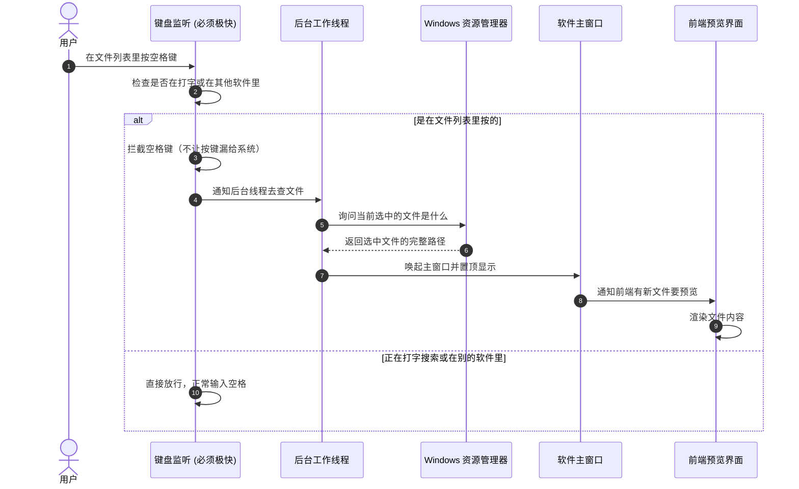
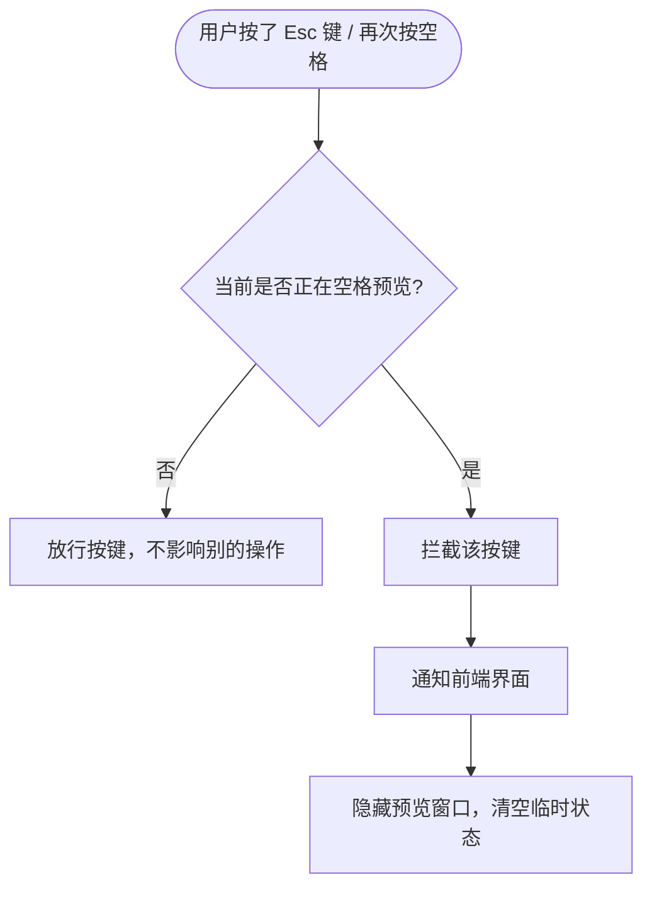

# Windows 系统集成与空格快速预览机制

## 目标

KView 在 Windows 平台上提供类似 Mac QuickLook 的即时文件预览体验：在资源管理器或桌面上选中任意文件，轻按空格键就能秒开预览窗口；再按一次空格或按 Esc 就能立即关掉。同时支持在右键菜单中设置默认打开方式。

## 边界

### 负责范围
- **空格键与 Esc 键监听**：通过底层全局键盘钩子，准确判断当前是否在桌面或资源管理器中按下了空格。
- **定位当前选中的文件**：遍历 Windows 资源管理器窗口，精准找出用户当前鼠标选中的是哪个文件（兼容 Win10 以及 Win11 的多标签页窗口）。
- **快速预览窗口控制**：处理空格键呼出、置顶显示、单窗口复用以及按 Esc 快速隐藏。
- **Windows 文件关联设置**：在当前用户注册表里添加或移除文件打开方式。

### 不负责范围
- 不负责非 Windows 系统（如 macOS / Linux）的原生快捷键接入。
- 不负责文件内容的具体解码渲染（由各查看器负责）。

## 规则

1. **正常打字与其它软件绝对不拦截空格**：
   - 只有当用户确实在“桌面”或“资源管理器文件列表”中按空格，才触发预览。
   - 如果用户正在资源管理器的搜索框、地址栏里打字，或者在重命名文件，绝对不能拦截空格；在浏览器、记事本等其他任何软件里，也必须完全放行，不能影响用户正常敲空格。
2. **按键监听绝不卡顿（耗时工作移到后台线程）**：
   - 键盘钩子函数必须在极短时间内（毫秒之内）立刻返回，里面严禁做读取磁盘、遍历窗口等耗时操作，否则会导致整台电脑键盘卡死。
   - 钩子只负责发一个通知给后台工作线程，由后台工作线程去慢慢找选中的文件，找到后再唤出界面。
3. **窗口随叫随到，按 Esc 只隐藏不退出**：
   - 按空格呼出预览时，直接复用当前窗口换上新文件，不要反复创建新窗口。
   - 按 Esc 键或者再按一次空格关闭预览时，窗口只是藏起来，不退出主程序，方便下次按下空格继续秒开。
   - KView 内的空格关闭由前端处理，仅在当前空格预览标签生效；输入控件、弹窗和动态照片播放保留自身的空格交互。
   - 切换到其他标签时解除空格预览关联，但保留原标签及其正在进行的文档加载；同一标签的新加载替代旧加载，关闭标签后丢弃尚未完成的加载结果并释放资源。
4. **免管理员权限安全注册文件关联**：
   - 所有文件关联只写入当前用户配置（`HKEY_CURRENT_USER`），不需要弹出 UAC 提权弹窗，普通权限就能顺利完成。
   - 注册或取消后，通知系统立即刷新图标，让资源管理器马上看到变化。

## 模块职责

### 主窗口置顶

- 标题栏提供图钉按钮，调用 Rust 的读取和设置置顶接口；接口使用 Tauri 原生窗口能力，同时适用于 Windows 与 macOS，不扩大前端窗口写权限。
- 状态仅保留在 Rust 当前进程中。系统设置成功后更新状态，失败在界面提示；隐藏、最小化以及低内存模式重建窗口后保持，退出进程后重置。
- 置顶不改变已有的空格预览、Esc、关闭行为和未保存保护。进入日志或文本对比前解除相关文档的空格预览关联，避免资源管理器方向键替换其内容。
- 低内存模式成功销毁主窗口后，同时失效日志窗口代次并释放注册会话；主窗口重建分配新代次，旧窗口尚未结束的日志读取不能注册新会话。

```
┌────────────────────────────────────────────────────────┐
│             Windows 资源管理器 / 桌面窗口               │
└───────────────────────────┬────────────────────────────┘
                            │ 全局键盘钩子 (WH_KEYBOARD_LL)
┌───────────────────────────▼────────────────────────────┐
│               windows_space_open.rs                    │
│  - 键盘钩子：快速判断按键，立刻通知后台线程             │
│  - 后台工作线程：遍历资源管理器，找出选中的文件绝对路径 │
│  - 状态标记：记录当前是否正在预览                        │
└─────────────┬────────────────────────────┬─────────────┘
              │ 发送事件:                  │ 发送事件:
              │ space-open-path-changed    │ space-open-close-requested
┌─────────────▼────────────────────────────▼─────────────┐
│               desktop-lifecycle.ts                     │
│  - 前端收到事件，取出文件路径                            │
│  - 驱动工作区立刻切换或显示预览文档                      │
└────────────────────────────────────────────────────────┘
```

- **按键监听调度 (`windows_space_open.rs`)**：负责安装全局键盘监听，在合适的时候拦截空格和 Esc 键。
- **选中文件查找器 (`windows_space_open.rs::selected_path`)**：深入 Windows Shell 内部，准确查出当前选中的文件路径（特别支持了 Win11 多个标签页的场景）。
- **文件关联注册 (`file_associations.rs`)**：安全读写注册表，帮用户把 KView 设为默认查看器。
- **前端事件衔接 (`desktop-lifecycle.ts`)**：作为前端的耳朵，收到后台发来的“空格预览”或“按 Esc 关闭”通知后，调用界面对应动作。

## 流程

### 1. 按空格键快速预览的整个过程



### 2. 按 Esc 退出预览流程



## 关键决策

1. **Win11 多标签资源管理器精准焦点匹配方案**：
   - *决策*：Win11 资源管理器在一个大窗口里可以开多个 Tab 标签页。系统不能只看顶层大窗口，而是需要深入找到用户当前正在操作的具体那一个标签页（ShellView）。
   - *原因*：如果只看顶层窗口，经常会拿到其他未激活标签页里残留选中的文件，导致“看 A 标签里的文件，却预览了 B 标签里的文件”。
2. **注册表限定在当前用户（HKCU），无需管理员权限**：
   - *决策*：所有关联项只注册在当前用户的配置目录下。
   - *原因*：用户不需要每次点设置都弹系统权限警告（UAC），绿色环保，卸载或关闭关联时也能一键清理干净，不留系统垃圾。
